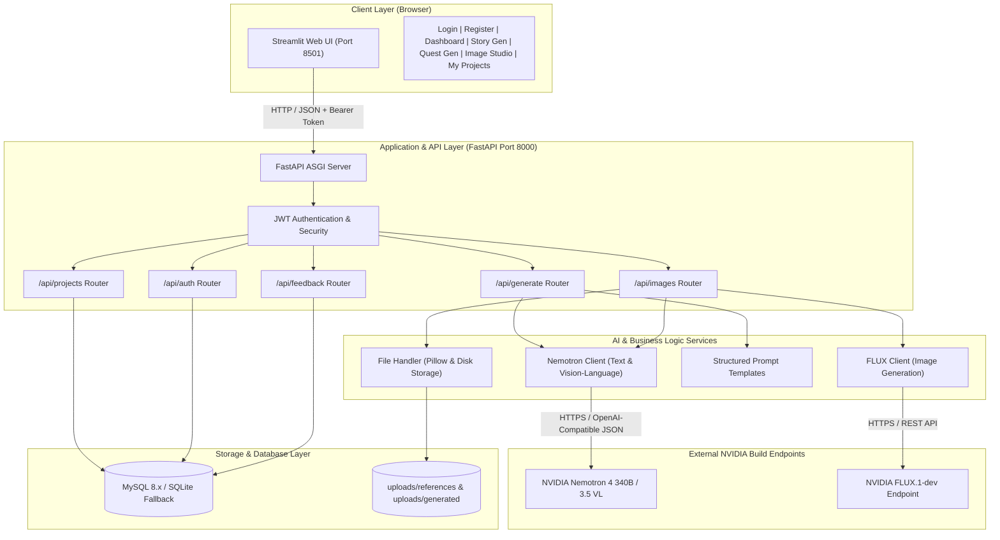
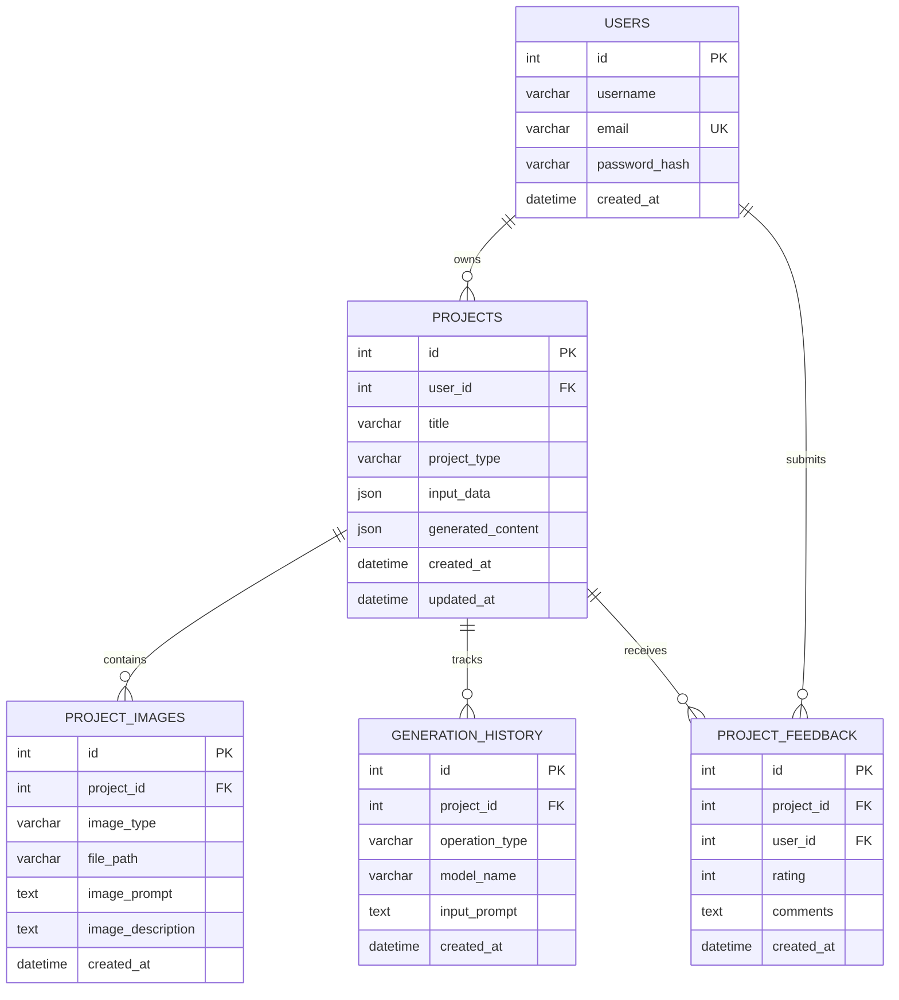
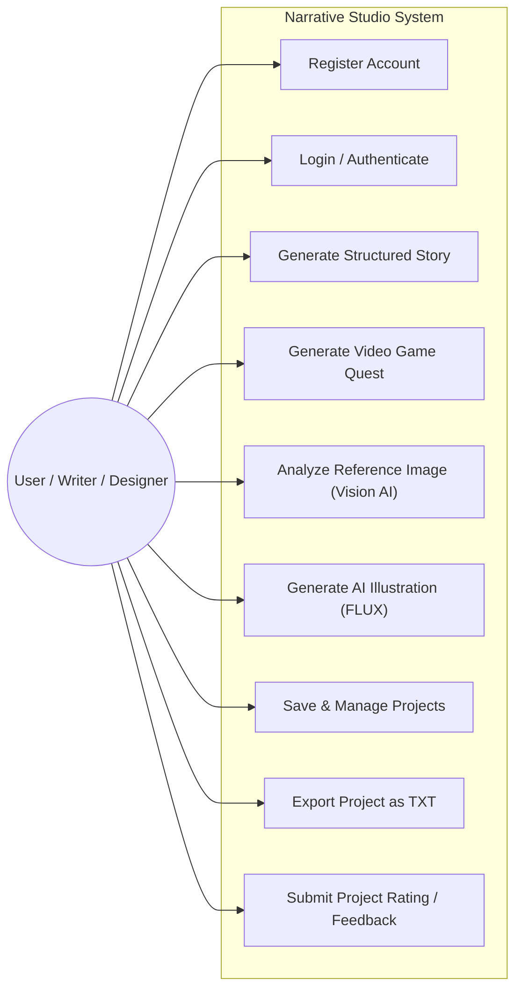
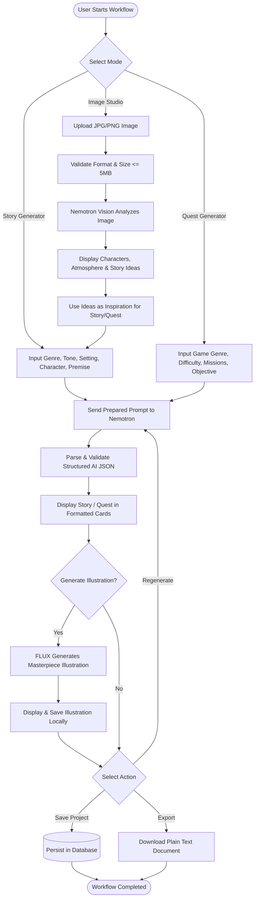
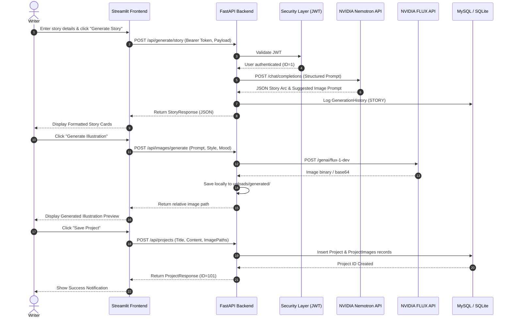

# System Architecture & UML Diagrams
## Narrative Studio: Multimodal AI-Powered Story & Game Quest Generator

---

### 1. System Architecture Diagram

---

### 2. Database Entity-Relationship (ER) Diagram

---

### 3. Use Case Diagram

---

### 4. Activity Diagram: Multimodal Generation Workflow

---

### 5. Sequence Diagram: Text-to-Story-to-Image Generation

